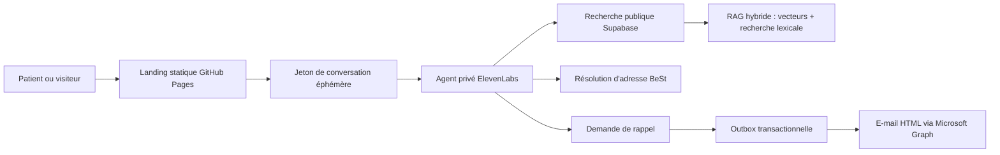

# CHRSM — site Meuse · démonstrateur voicebot

Prototype de landing page et d’accueil vocal de première ligne pour le
CHRSM — site Meuse à Namur. Le démonstrateur informe, oriente et peut recueillir
une demande de rappel consentie. Il reprend l’univers visuel du CHRSM, les
visuels fournis pour le projet et les composants Banana Navy / STRIKE IT.

> **Démonstration non officielle.** Ce projet n’est ni un dispositif médical,
> ni un canal d’urgence, ni un système de prise de rendez-vous en production.
> En cas d’urgence vitale, il faut appeler le **112**. Pour un médecin de garde
> en dehors des heures habituelles, le numéro public belge est le **1733**.

## Ce que couvre la démo

- informations pratiques contrôlées : accès, parkings, visites, documents,
  services et principaux contacts ;
- recherche sémantique dans une base de connaissances issue de sources
  publiques officielles ;
- conversation vocale en français de Belgique avec un agent ElevenLabs privé ;
- vérification ponctuelle d’une adresse belge avec BeSt, uniquement lorsque
  cette vérification est utile ;
- collecte minimale d’une demande de rappel avec consentement explicite ;
- mise en file d’un e-mail HTML interne reprenant la demande de rappel.

La démo **ne réserve, ne déplace et n’annule aucun rendez-vous**. Lorsque cette
intention est détectée, le bot explique que la fonction sera disponible dans la
version complète après déploiement, puis propose un rappel sans promettre de
créneau ni de délai.

## Architecture



Principes structurants :

- le site est un export statique Next.js ;
- la clé ElevenLabs ne quitte jamais le serveur : le navigateur reçoit
  seulement un jeton de conversation court ;
- les outils ElevenLabs appellent des Edge Functions authentifiées côté
  serveur ;
- les passages de connaissance restent en français, tandis que la requête
  sémantique est normalisée en anglais pour le modèle `gte-small` ;
- les données de rappel sont séparées des connaissances publiques et de la
  résolution d’adresse ;
- l’adresse vérifiée n’est jamais rattachée à la demande de rappel ;
- l’e-mail est signalé comme **mis en file**, jamais comme livré tant que le
  fournisseur ne l’a pas confirmé ;
- n8n n’est pas nécessaire au chemin critique de cette démo : une outbox
  Supabase et Microsoft Graph couvrent la livraison et les reprises. Il pourra
  être ajouté plus tard pour une intégration CRM ou ticketing.

## Arborescence utile

| Dossier | Rôle |
| --- | --- |
| `site/` | Landing page Next.js, console vocale et export statique |
| `agent/` | Prompt, contrat des outils et synchronisation prudente ElevenLabs |
| `knowledge/` | Registre versionné des faits et sources publiques officielles |
| `supabase/` | Architecture, migrations et Edge Functions Supabase déployées |
| `assets/` | Logos, icônes et visuels de conception |
| `output/` | Présentations de référence du projet |

## Lancement local

Prérequis : Node.js `22.13.0` ou une version compatible plus récente, et npm.

```bash
cd site
npm ci
cp .env.example .env.local
npm run dev
```

Ouvrir ensuite [http://localhost:3000](http://localhost:3000).

Pour vérifier localement un export statique servi à la racine :

```bash
cd site
npm run build
npm test
npm run start
```

Le workflow de déploiement reconstruit ensuite le même site avec
`GITHUB_PAGES=true` afin d’ajouter le préfixe public
`/chrsm-voicebot-demo`. Ce second export est conçu pour être servi sous ce
sous-chemin GitHub Pages, pas directement à la racine de `localhost`.

La validation locale de l’agent est volontairement sans écriture distante :

```bash
node agent/sync-agent.mjs
```

Le résultat attendu contient `remote_calls: false`. Les opérations ElevenLabs
distantes demandent des drapeaux de confirmation explicites et des secrets
injectés au moment de l’exécution ; elles ne font pas partie de la CI.

## Variable publique de la landing page

Créer `site/.env.local` pour le développement et définir le même nom comme
**Variable Actions** dans les réglages GitHub du dépôt :

| Variable | Contenu attendu |
| --- | --- |
| `NEXT_PUBLIC_CHRSM_VOICE_SESSION_URL` | URL HTTPS de création du jeton de conversation éphémère |

Cette valeur est incorporée dans le JavaScript statique et doit donc être
considérée comme publique. Les URLs des outils de rappel et de résolution BeSt
restent configurées côté agent ElevenLabs et ne sont pas injectées dans la
landing page. Les Edge Functions appliquent une liste d’origines autorisées,
une limitation de débit, une validation stricte des champs et des réponses
CORS minimales.

Ne jamais définir dans une variable `NEXT_PUBLIC_*`, dans GitHub Pages ou dans
le dépôt :

- `ELEVENLABS_API_KEY` ;
- un jeton d’outil ElevenLabs ;
- une clé Supabase `service_role` ;
- les identifiants Microsoft Graph ;
- un jeton de worker ou une URL signée durable.

Ces secrets restent dans les coffres et environnements serveur prévus à cet
effet.

## Sécurité, vie privée et limites fonctionnelles

- aucune recommandation médicale, aucun diagnostic et aucune interprétation de
  résultat ;
- aucune collecte du numéro de registre national, de la date de naissance ou
  d’un détail clinique ;
- aucun formulaire de rappel public sur la landing page ;
- dans le parcours vocal, collecte limitée au nom, au téléphone, au service,
  à la préférence de rappel et au consentement, sans demander d’adresse e-mail ;
- téléphone normalisé, tailles bornées, anti-abus, idempotence et refus des
  champs supplémentaires côté serveur ;
- agent privé, enregistrement vocal désactivé, conservation configurée à zéro,
  mémoire utilisateur désactivée ;
- sources datées et réponses prudentes lorsque l’information est dynamique ;
- reprise humaine ou renvoi vers le numéro général lorsqu’un fait n’est pas
  suffisamment fiable.

Le voicebot ne doit jamais annoncer qu’un rendez-vous a été pris. Une demande
de rappel confirme uniquement l’enregistrement et la transmission à l’équipe.
La mise en file d’un e-mail interne ne constitue pas une confirmation de
livraison.

## Sources publiques

Le registre de référence est
[`knowledge/official-source-registry.json`](knowledge/official-source-registry.json).
Il indique la source, la date de vérification et le caractère dynamique de
chaque fait. Principales sources :

- [CHRSM — Consultations à Namur](https://meuse.chrsm.be/consultations-%C3%A0-namur) ;
- [CHRSM — Rendez-vous en ligne pour Namur](https://meuse.chrsm.be/rendez-vous-en-ligne-pour-namur) ;
- [CHRSM — Accès au site Meuse](https://meuse.chrsm.be/node/80) ;
- [CHRSM — Informations pratiques et visites](https://meuse.chrsm.be/en-pratique/urgences) ;
- [CHRSM — Brochure d’accueil 2025-2026](https://meuse.chrsm.be/sites/default/files/portail-content/brochure-accueil-meuse-2025-26_1.pdf) ;
- [SPF Santé publique — Centrale d’urgence 112](https://www.health.belgium.be/fr/themes/sante/aide-medicale-urgente/acteurs-laide-medicale-urgente/centrale-durgence-112) ;
- [SPF Santé publique — Médecin de garde 1733](https://www.health.belgium.be/fr/themes/sante/aide-medicale-urgente/acteurs-laide-medicale-urgente/besoin-dun-medecin-garde-composez-1733) ;
- [BOSA — BeSt Address Services](https://bosa.belgium.be/fr/services/best-address-services).

Les horaires, numéros, lignes de bus et modalités de service peuvent évoluer.
Ils doivent être revalidés avant une présentation client ou une mise en
production.

## Validation continue

Le workflow `validate.yml` exécute :

1. installation déterministe avec `npm ci` ;
2. typecheck et lint ;
3. export statique avec le préfixe GitHub Pages ;
4. tests du site exporté ;
5. validation JSON du registre et du contrat agent ;
6. dry-run de la synchronisation ElevenLabs, avec vérification qu’aucun appel
   distant n’est autorisé.

La validation ne contacte ni ElevenLabs, ni Supabase, ni Microsoft Graph.

## Déploiement GitHub Pages

Le projet est prévu pour le dépôt `Banana-Navy/chrsm-voicebot-demo` et l’URL :

`https://banana-navy.github.io/chrsm-voicebot-demo/`

1. Dans **Settings → Pages**, sélectionner **GitHub Actions** comme source.
2. Définir la variable publique listée plus haut dans
   **Settings → Secrets and variables → Actions → Variables**.
3. Autoriser cette origine exacte dans les Edge Functions publiques.
4. Fusionner sur `main` ou lancer manuellement le workflow
   **Deploy GitHub Pages**.

Le workflow :

- construit `site/` avec `GITHUB_PAGES=true` ;
- vérifie que la variable publique de session vocale est présente ;
- ajoute `.nojekyll` à l’export pour préserver les ressources `/_next` ;
- téléverse exclusivement `site/out` ;
- déploie l’artefact dans l’environnement protégé `github-pages`.

Le chemin public `/chrsm-voicebot-demo` est configuré dans
`site/next.config.ts`. Si le dépôt est renommé, ce chemin et les métadonnées du
site doivent être adaptés avant le prochain déploiement.

## Marques et responsabilité

Les marques, logos et contenus CHRSM restent la propriété de leurs titulaires.
Banana Navy et STRIKE IT apparaissent ici dans le contexte d’une proposition de
démonstration. Toute publication de production nécessite validation éditoriale,
sécurité, RGPD, accessibilité, exploitation et accord des parties concernées.
